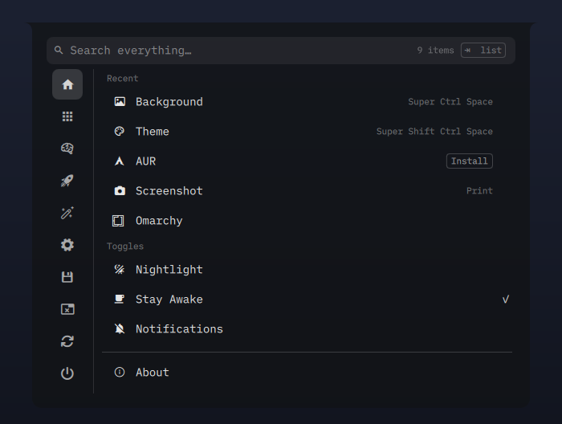

<div align="center">

# Compass

A command menu for Omarchy: category rail, recents, fuzzy search and keyboard hints.

<p>
  <a href="LICENSE"></a>
  
  
  
</p>

[Install](#install) · [Controls](#controls) · [How it works](#how-it-works) · [Development](#development)



</div>

---

### Features

| Feature | Description |
| --- | --- |
| Category rail | An icon rail down the left lists every top-level menu. Hover an icon for its name. |
| Home | Recents ranked by use, three toggles and root-level actions in one list. |
| Fuzzy search | Type anywhere. Matched letters are bold, and a result count sits in the search bar. |
| Scoped search | Typing from the rail searches everything. Typing inside a menu searches that menu. |
| Breadcrumbs | Click a crumb to jump back up. |
| Keyboard hints | The selected row shows a `⏎` cap, and the search bar shows what `Tab` and `Esc` will do. |
| Empty state | A search with no matches suggests recent items to try. |
| Shortcuts | Key bindings are read from your Hyprland bindings and shown on the row. |
| Same routing | Every `omarchy menu`, `omarchy-menu-select` and `omarchy-menu-input` call lands here. |

The menu hangs from the top edge under the bar clock and opens the way the
control center does: the clock's pill stretches sideways, then drops.

---

### Requirements

- Omarchy Quattro shell and Quickshell `0.3.2`
- `omarchy` and `python3` on your PATH

No extra packages, accounts or network services.

### Install

```sh
omarchy plugin add https://github.com/Aicyraa/omarchy-compass-menu.git --enable
omarchy restart shell
```

Compass is built to stand in for the built-in `omarchy.menu`, so your existing keybind,
bar button and `omarchy menu` calls open it. If the stock menu still appears, turn it
off: `omarchy plugin disable omarchy.menu`.

Update with `omarchy plugin update io.github.aicyraa.compass-menu`, then
`omarchy restart shell`. The plugin is `keepLoaded`, so a restart is needed after every
update.

### Controls

| Key | Action |
| --- | --- |
| `Super` + `Space` | Open Home |
| `↑` `↓` | Move on the rail or the list |
| `→` or `Tab` | Step in from the rail |
| `⏎` | Run the selected row. Only Enter runs anything |
| `←` or `Backspace` | Go back |
| `Esc` | Clear the search, then close |
| `Delete` | Forget a Home row. In Apps or search it offers uninstall |
| Type | Search |

Toggles flip in place and leave the menu open.

---

### How it works

- Items come from `default/omarchy/omarchy-menu.jsonc` and your
  `~/.config/omarchy/extensions/omarchy-menu.jsonc`.
- Use counts live in `~/.local/state/compass-menu-recent.json` and fade with a
  one-week half-life. `system.*` and `remove.*` are never recorded. Only use through
  this menu counts: a keybind that runs a command directly never passes through it.
- Shortcut hints come from parsing `default/hypr/bindings/*.lua` and your
  `bindings.lua`.
- Apps come from the menu's own `AppLibrary`, because the shell never gives a cloned
  plugin its library. If `childCount apps` is 0, check that first.
- Dmenu mode keeps the stock narrow card. About 20 Omarchy scripts depend on it.
- Compass is a copy of `omarchy.menu`, so upstream fixes do not arrive by themselves.
  Compare against `/usr/share/omarchy/shell/plugins/menu/` after Omarchy updates.

### Development

```sh
node test.js                          # model tests
python3 deploy.py && omarchy restart shell
bash tools/preview/render.sh          # regenerate preview.png
```

Never send `wtype` keys to the live menu: it takes the keyboard, so real typing lands
in its search and an injected key can run a result.

### Preview image

`preview.png` is rendered from the production `Menu.qml` in a throwaway Quickshell
config (`tools/preview/render.sh`). It has no keyboard focus, a neutral gradient in
place of the desktop, and sample recents that contain no applications. It does not read
or write your Omarchy configuration or state, and it is not installed by `deploy.py`.

### Removing it

```sh
omarchy plugin disable io.github.aicyraa.compass-menu
```

Or restore the `omarchy.menu` entries from a `shell.json` backup. Your recents file can
be deleted safely.

### Credits and license

Compass is based on the default [Omarchy](https://github.com/basecamp/omarchy) menu
(`omarchy.menu`), © David Heinemeier Hansson, MIT licensed. It keeps Omarchy's menu
data, dmenu behaviour and shell libraries, and adds the rail, Home, search and hint
work on top.

MIT. Copyright © 2026 Aicyraa, and © David Heinemeier Hansson for the Omarchy code it
derives from. See [LICENSE](LICENSE).
